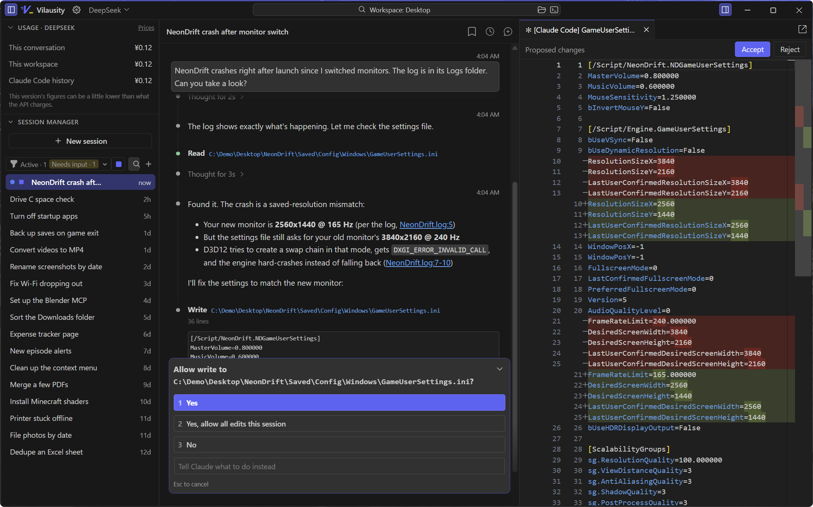
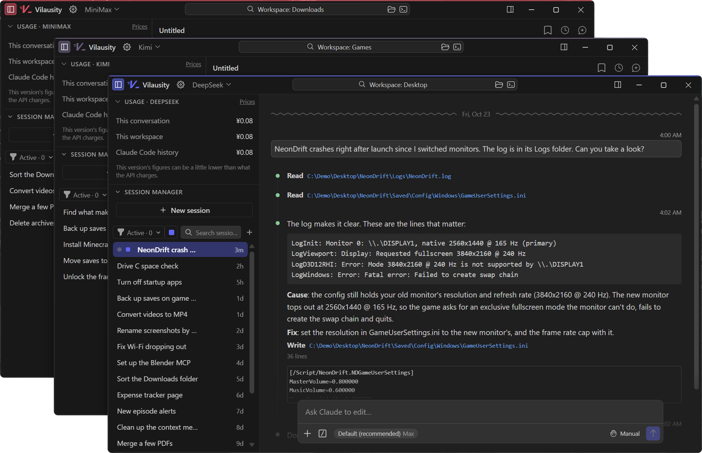
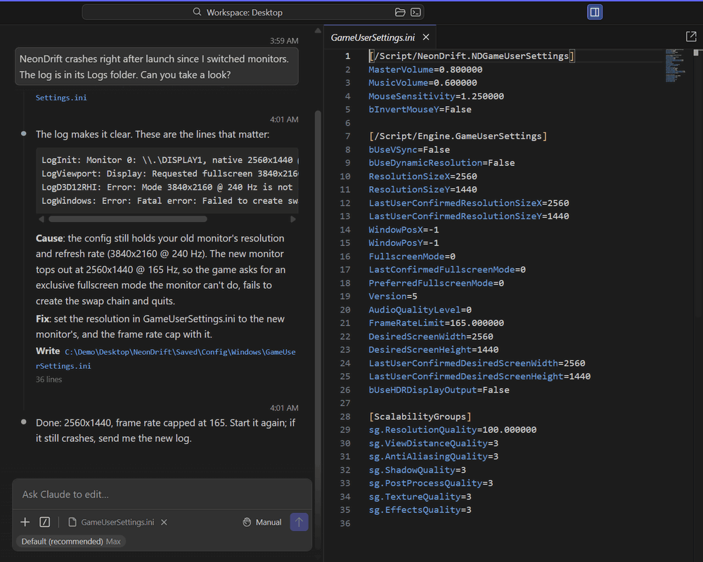

#  Vilausity

A standalone Claude Code desktop app for Windows: the official core with every feature, in a clean VS Code-style interface

No terminal, no setup to fiddle with, no Claude account needed: add an API key and get to work

[Download](https://github.com/Teabie666/vilausity-claude-code-gui-shell/releases/latest) · [中文](README.md)

> A third-party project made by one person, not affiliated with Anthropic or Microsoft. The Claude Code extension is Anthropic's software; Vilausity neither bundles nor modifies it.
>
> Vilausity is still in testing. Found a bug or have an idea? [Open an issue](https://github.com/Teabie666/vilausity-claude-code-gui-shell/issues).

## Doing it all by hand gets old, right?

- Fix software, track down errors, tweak system settings
- Organize files: batch rename, sort, convert formats
- Write small scripts, tools and web pages for yourself
- Add an MCP server (**one sentence does it**) and let the AI drive your browser, SolidWorks, DaVinci Resolve, Blender and other tools

## Why Vilausity?

- **The official core**: at its heart is the official Claude Code extension, so whatever it can do, Vilausity can do. The extension updates itself, and if an update breaks something, one click takes you back to the previous version.
- **Chinese model providers**: extra work went into Chinese model APIs, with presets for DeepSeek, Kimi, GLM, Qwen and more; add a key and go. Each window can use its own provider and takes on its color (customizable!), and you see what each conversation costs (not exact yet, but I tried).

  

- **VS Code's design language**: themes, fonts and shortcuts are all yours to change, and it feels as quick and clean as VS Code. The interface comes in English and Chinese, the extension's own UI included. The editor is Monaco, the one inside VS Code: review changes, read plans, or edit something yourself.
- **Comments**: want to get your point across quickly? Select a passage in a file or the conversation, write a comment, and it goes out with your next message, quote included.

  

- **Let it work**: go play a game while it gets on with the job. Its taskbar button changes color, so you never miss a question it has for you.
- **At home on Windows**: optionally add "Open with Vilausity" to File Explorer's context menu; for jobs that need administrator rights, open an administrator window and carry on.

All features

**Conversations**

- Tabs: several conversations open at once, and tabs in the editor pane too
- A single click in the session list just previews a conversation (italic tab title); a double click or a new message keeps it open
- Ctrl+Shift+T brings back a closed conversation; open conversations come back after a restart; conversations are kept for good by default (Claude Code on its own clears them after 30 days)
- Ctrl+P searches past conversations: titles, contents, and the files they read or changed
- Message markers by the scrollbar, one per message of yours: hover for a list, click to jump
- Expanding Claude's thinking doesn't push away what you were reading
- File links in a conversation: Shift+click opens a file with its default program; right-click to show it in File Explorer or copy its path
- Drop files on the window and where you drop them decides: on the session list = copy into the workspace and mention them, on the conversation = attach, on the right = open in the editor
- Delete conversations from the session list (the extension itself can only archive them); the top of the list shows how many are working and how many wait for you
- The taskbar button shows Claude's state (a green bar while it works, yellow when it waits for you), and the title bar's logo blinks along

**API providers**

- Presets: Claude subscription, Anthropic API, DeepSeek, Kimi, GLM, Qwen, Volcano Engine Ark, MiniMax, OpenRouter, or any Anthropic-compatible API
- Main model, model tiers, subagents, headers and timeouts are all adjustable; keys are stored encrypted with Windows' DPAPI
- Each folder remembers its provider, switched with one click in the title bar; the window, logo and taskbar icon take on the provider's color
- Make a desktop shortcut for a provider if you like, to open Vilausity straight on it
- Spending per conversation, per workspace and across all of Claude Code; prices can vary by time of day and holidays, and DeepSeek's, Zhipu's and Qwen's come filled in
- The session list marks conversations with their provider's color and can show just the current provider's
- Long conversations stay smooth on APIs that stream a token at a time, like DeepSeek's
- On a Claude subscription, usage limits show when they reset, to the minute

**Editor and files**

- Monaco, VS Code's editor: syntax highlighting, Ctrl+S to save, auto save if you want it
- Review Claude's proposed changes in a diff tab: accept, reject, or edit them first
- Markdown opens as a preview (images included), one click back to the source
- Plans from plan mode open on the right
- Files reload when Claude changes them; tabs can pop out into windows of their own
- Comment on a selection in a file, a Markdown preview, a diff or the conversation

**Interface and settings**

- VS Code's 6 built-in themes; separate fonts for the interface, the conversation and code
- A settings editor, or settings.json directly (side by side with the defaults, with completion and validation)
- Rebind shortcuts by pressing the new keys; conflicts are flagged
- Mouse back and forward buttons move between the tabs you used; Esc closes a file you were just peeking at on the right
- Command palette Ctrl+Shift+P, zoom Ctrl+= / Ctrl+-, find in the conversation Ctrl+F
- English and Simplified Chinese; in Chinese, the extension's own UI is translated too (can be turned off)

**Windows**

- "Open with Vilausity" in File Explorer's context menu (and an administrator one)
- An administrator instance runs alongside the normal one and shares its settings and API providers
- Multiple windows, one per folder; the windows you had open come back next time
- Buttons by the search box open the workspace in File Explorer or a terminal in it

**Extension**

- On first start, the official extension downloads from Open VSX and is verified; if VS Code or VSCodium already has it, that copy is used; or pick a .vsix yourself
- Auto update can be turned off; roll back with one click, pin a version, or use an Open VSX mirror
- If the extension crashes, one click restarts it, with open files and unsaved changes intact

**For tinkerers**

- Local API: scripts and bots on your computer can see what the windows and conversations are doing, open folders, files and conversations, and run commands; with one more switch on, they can send messages too
- Command line: open a folder or conversation, pre-fill a prompt, pick a provider
- Change Vilausity itself: open its source in Vilausity and have Claude change it; see [below](#missing-a-feature-build-it)

## Never used an agent? Relax, but not too much

**API key**: without a Claude account, get a key from a model provider you like. I recommend DeepSeek (it's cheap: I spend a dozen-odd yuan, about two dollars, a month): sign up on its [platform](https://platform.deepseek.com/api_keys), top up, and create an API key. Then add that provider with the API provider button in the title bar and paste the key; the provider's "Setup guide" link goes to its official instructions.

**It really does things**:

- Editing files, running commands, changing system settings: it all happens for real on your computer. The mode button starts on "Manual", so it asks before acting; click "Yes" once you're sure
- Switch to "Auto" or "Bypass permissions" and it stops asking (*leave them off unless you like surprises*)
- If it breaks something, "Rewind to…" (Shift+Esc) undoes its changes to files; what commands did (deleting files, editing the registry, installing software) can't be undone, so back up what matters first
- In an administrator window it can change system files and the registry, so mistakes cost more; be careful

## Wow, so what is Claude Code?

Claude Code is an AI agent made by Anthropic: tell it in plain words what you want, and it reads and edits files and runs commands on your computer until the job is done. (The interface calls it Claude throughout, but on the DeepSeek API the thinking is done by DeepSeek's model; Claude Code handles how the work gets done.) It's the middle column of Vilausity. What to know to get going:

- **Workspace**: it works in the folder you open, shown in the title bar's search box as "Workspace: folder name". To fix a game, open the game's folder; to tidy your downloads, open Downloads. Ctrl+R switches folders, or right-click a folder in File Explorer and choose "Open with Vilausity". *(Or just stay in your home folder for everything.)*
- **One job, one conversation**: "New session" (Ctrl+N) starts a new one. The longer a conversation gets, the slower and pricier it gets, so start fresh for each new job; the session list on the left keeps the old ones.
- **Show it things**: type @ to mention a file, or drag files and screenshots into the conversation.
- **Plan the big jobs**: press Shift+Tab in the message box to switch to plan mode; it writes up a plan first and only starts once you agree. (Plan mode is seriously great!)
- **Make it remember you**: standing instructions go into CLAUDE.md, like "answer in English" or "my games are in D:\Games". For every conversation, put it in `%USERPROFILE%\.claude\CLAUDE.md`; for one folder, in that folder. Not sure what to write? Have it write it.
- **Level it up**: MCP servers (plugins for the AI) and skills (packaged know-how) let it drive more software and follow set routines. **Want one? Ask it to install it.**

To dig deeper, see the official [Claude Code docs](https://code.claude.com/docs/en/overview); they cover the terminal, but the ideas are the same.

## FAQ

How is it different from the official Claude Code?

The part that does the work is the official one: Vilausity runs the Claude Code extension for VS Code as Anthropic publishes it, unmodified, with a Claude account or an API key. The difference is the layer around it: no VS Code to install, no terminal, extra work for Chinese model providers, a Chinese interface, and features the official one doesn't have, like comments, search and multiple windows. Also, the official desktop app needs a paid Claude plan; Vilausity works with an API key.

What about dsh?

DeepSeek Harness goes "everything is a plugin": anything can be swapped or changed, which suits people who want to rework the agent itself. It's still in preview, and its core plugins are still changing *(a bare dsh, without hours of plugin research, is honestly unusable!)*. Claude Code is a mature product polished for over a year, with planning, subagents, permissions and rewind out of the box; without extra plugins, it gets a lot more done *(dsh can do much of it too, just far less efficiently)*. Both can run DeepSeek's models: DeepSeek in Vilausity means DeepSeek's brain with Claude Code's hands. **If you just want an AI that gets things done, you can skip researching dsh.** *(Or have DeepSeek research dsh for you, in Vilausity?)*

An extension update broke something. What now?

The Claude Code extension is maintained by Anthropic and updates often; now and then a new version doesn't fit Vilausity. The "Extension Version" section of the settings rolls back to the previous version with one click; you can also turn off auto update or pin a version.

Where is my data, and how do I uninstall completely?

Vilausity's settings, API providers and the downloaded extension live in `%APPDATA%\Vilausity`; uninstalling keeps them, so delete the folder by hand if you no longer need it. Conversations are stored by Claude Code itself in `%USERPROFILE%\.claude`, shared with the command-line version and the VS Code extension; before deleting it, make sure no other Claude Code is using it.

Mac or Linux?

Only Windows 10 / 11 (x64) for now: the context menu, the taskbar states and the key encryption all use Windows' own features.

## Missing a feature? Build it

Vilausity itself was talked into existence in Claude Code, one message at a time. Missing something? Open its source in Vilausity and tell Claude what you want. Rather not touch code? Let your scripts and bots drive it through the local API.

See [vibe-coding.en.md](vibe-coding.en.md) for how.

## About

This project started from my own needs, so its looks and features are on the subjective side. I'm an engineering student in Australia who never studied software development; I just found the Claude app and the CLI ugly and awkward to use, and so Vilausity happened.

I'm no coder: nearly all of the code was written by Claude (Opus 5.5) **(on maximum effort, burning two full weekly quotas plus twenty-odd dollars)** in Claude Code and VSCodium, and the interface translation and some of the tests were done by DeepSeek subagents *(to save my subscription quota)*. I just started the project, made the calls, wrote the requirements, tested, wrote some of the docs and paid for the subscription (and slept).

How it was planned and how far it has come: [PLAN.md](docs/PLAN.md) (the plan), [ROADMAP.md](docs/ROADMAP.md) (progress), [design.md](docs/design.md) (visual design). The docs in docs/ are written mainly for Claude, in Chinese, so they read a bit dry.

## Feedback

Found a bug or have an idea? [Open an issue](https://github.com/Teabie666/vilausity-claude-code-gui-shell/issues). It's a one-person project, so replies may take a while.

## License

Copyright (C) 2026 Teabie

Vilausity is released under the [GNU General Public License v3.0 or later](LICENSE) (GPL-3.0-or-later). The license covers this repository's code only; the Claude Code extension is not part of it and comes under Anthropic's terms. The Noto Sans SC font that ships with the app is released under the [SIL Open Font License 1.1](https://openfontlicense.org); its license file sits next to the font.

Claude and Claude Code are trademarks of Anthropic; VS Code is a trademark of Microsoft.
