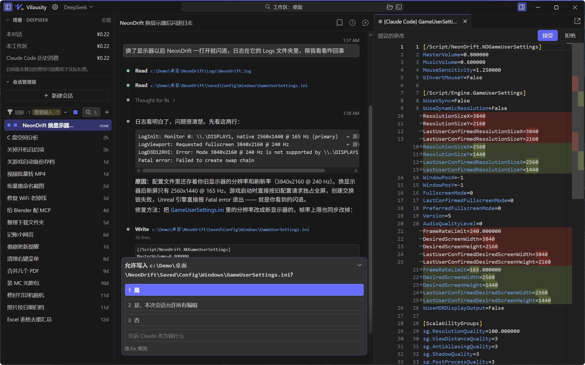
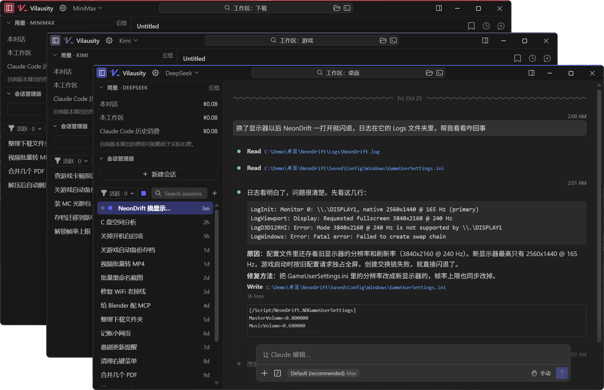
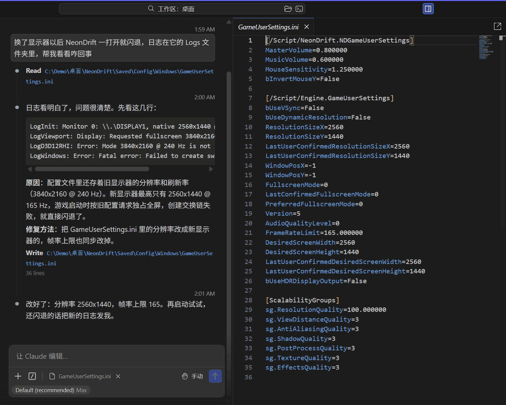

#  Vilausity

Windows 桌面独立 Claude Code 客户端：官方内核、功能满血，VS Code 风格的专业界面

抛开命令行、无需捣鼓部署、也不用 Claude 账号，填上 API key 就能开干

[下载](https://github.com/Teabie666/vilausity-claude-code-gui-shell/releases/latest) · [English](README.en.md)

> 本仓库为个人开发的第三方项目，与 Anthropic、Microsoft 没有关联。Claude Code 插件是 Anthropic 的软件，Vilausity 不打包、不修改。
>
> Vilausity 目前仍在测试阶段，遇到 bug 或者有想法欢迎[提 issue](https://github.com/Teabie666/vilausity-claude-code-gui-shell/issues)。

## 老老实实玩电脑，很枯燥吧

- 修软件、查报错、调系统设置
- 整理文件：批量重命名、分类、转格式
- 写自己用的小脚本、小工具、小网页
- 配上 MCP（**一句话就够**），让 AI 直接操作浏览器、SolidWorks、达芬奇、Blender 之类的生产力软件

## Why Vilausity?

- **官方内核**：核心就是官方 Claude Code 插件，它有的功能这里都有。插件自动更新，更新出了问题一键退回上个版本。
- **国内模型适配**：为国内模型的 API 接入做了更多适配，内置 DeepSeek、Kimi、GLM、千问等预设，填上 key 就能用。每个窗口可以用不同的接口，窗口颜色跟着变（可自定义！），每个对话花了多少钱也算给你看（目前没法完全算准，但是我努力了）。

  

- **VS Code 界面设计语言**：主题、字体、快捷键都能改！VS Code 般简洁快速的使用体验。支持中文 UI，插件内部的界面也有汉化。内置 VS Code 同款 Monaco 编辑器内核，看改动、规划，亦或自己改点东西都在这。
- **评论**：想与 AI 高效沟通？在文件或对话里选中一段写评论，跟下一条消息一起发送，原文也带得上。

  

- **放着它干活**：你去打游戏，它干它的，任务栏按钮变色提示，不错过 AI 想问你的任何问题。
- **跟 Windows 贴合**：资源管理器的右键菜单里可选"用 Vilausity 打开"；需要管理员权限的活，开个管理员窗口接着干。

全部功能

**对话**

- 标签页设计，同时打开多个对话用标签页切换，编辑器侧栏依旧标签页
- 在会话列表里单击是临时看看（标签页标题是斜体），双击或发了消息才正式打开
- 关掉的对话 Ctrl+Shift+T 找回来；重启后打开的对话自动恢复；对话默认永久保留（Claude Code 自己默认 30 天后清理）
- Ctrl+P 搜索历史对话：标题、内容、读写过的文件都能搜
- 滚动条旁边的消息定位点：一条横线一条你的消息，悬停列出、点击跳转
- 展开思考时，正在看的位置不会被推走
- 对话里的文件链接：Shift+点击用默认程序打开，右键能在资源管理器中显示、复制路径
- 拖文件进窗口按位置决定怎么处理：拖到会话列表 = 复制进工作区并在对话里引用，拖到对话区 = 作为附件，拖到右边 = 在编辑器中打开
- 会话列表能删除对话（插件原生只能归档），顶上显示几个对话在干活、几个在等你
- 任务栏按钮显示 Claude 的状态（干活走绿条，等你变黄），标题栏的 logo 也跟着闪

**API 接口**

- 预设：Claude 订阅、Anthropic API、DeepSeek、Kimi、GLM、千问、火山方舟、MiniMax、OpenRouter，也能自定义兼容接口
- 主模型、各档模型、子代理、请求头、超时都能改；密钥用 Windows 的 DPAPI 加密保存
- 每个文件夹记住自己的接口，标题栏一键切换；窗口、logo、任务栏图标跟着接口变色
- 需要就给某个接口建桌面快捷方式，双击直接用这个接口打开
- 花费按本对话、本工作区、Claude Code 历史消费统计；价格能按时段、节假日分档，DeepSeek、智谱、千问的价格已经填好
- 会话列表按接口标颜色，可以只看当前接口的对话
- DeepSeek 这类一个字一个字往外推的接口，长对话也不卡
- 用 Claude 订阅时，用量的重置时间精确到分钟

**编辑器和文件**

- VS Code 同款的编辑器内核（Monaco），语法高亮，Ctrl+S 保存，支持自动保存
- Claude 提议的改动在 diff 标签页里审：接受、拒绝，或者先改一改再接受
- Markdown 默认显示预览（能显示图片），一键切回源码
- 计划模式的计划在右边打开
- 文件被 Claude 改了自动重新载入；标签页能弹出成独立窗口
- 在文件、Markdown 预览、diff、对话里选中一段都能评论

**界面和设置**

- 6 套 VS Code 内置主题；界面、对话、代码三种字体分开设
- 设置有图形界面，也能直接改 settings.json（和默认设置左右对照，带补全和校验）
- 快捷键能改：按下新组合键就录上，冲突会提示
- 鼠标侧键在用过的标签页之间前进、后退；Esc 关掉右边临时看的文件
- 命令面板 Ctrl+Shift+P，缩放 Ctrl+= / Ctrl+-，对话内查找 Ctrl+F
- 简体中文和英文界面，插件自己的界面也翻成了中文（可以关）

**Windows**

- 资源管理器右键菜单"用 Vilausity 打开"（另有管理员版）
- 管理员实例：可以和普通实例同时开，设置和 API 接口共用
- 多窗口，同一个文件夹只开一个窗口；退出时记住开着的窗口，下次恢复
- 搜索框旁边一键在资源管理器中打开工作区、在工作区打开终端

**插件**

- 第一次启动自动从 Open VSX 下载官方插件并校验；电脑上的 VS Code、VSCodium 装过就直接用，也能手动选 .vsix
- 自动更新可以关；一键退回上一个版本，也能锁定版本、换 Open VSX 镜像
- 插件进程崩了一键重启，打开的文件和没保存的修改都还在

**给折腾的人**

- 本地接口：本机的脚本、机器人能看到窗口和对话的状态，打开文件夹、文件和对话，执行命令；另开一个开关后还能直接发消息
- 命令行参数：打开文件夹、对话，填好提示，指定接口
- 自己改 Vilausity：在 Vilausity 里打开它的源码让 Claude 改，见[下文](#想要的功能没有自己整)

## 没用过 Agent？放心，但别太放心

**API key**：没有 Claude 账号也没用过开放平台的话，先去喜欢的模型厂商获取一个。推荐 DeepSeek（大肥鱼傻不傻我能不知道吗，跟我一个月花十几块说去吧）：在[开放平台](https://platform.deepseek.com/api_keys)注册、充值，创建 API key。然后在标题栏的"API 接口"里添加对应的接口、填上 key；编辑页上的"配置说明"链到各家的官方说明。

**它是真的会动手**：

- 改文件、跑命令、改系统设置，都是在你电脑上真做。模式按钮默认是"手动"，动手前会先问你，确认了再点"是"
- 换成"自动"或"绕过权限"就不问了，直接开始享受（*怕爆炸别开*）
- 改坏了可以用"回退到…"（Shift+Esc）撤回它改过的文件；命令做的事（删文件、改注册表、装软件）撤不回来，重要的东西先备份
- 管理员窗口里它能改系统文件和注册表，出了错影响更大，小心使用

## 哇哦，所以什么是 Claude Code？

Claude Code 是由 Anthropic 开发的 AI agent：你用大白话说要干什么，它在你电脑上读文件、改文件、跑命令，把活干完。（界面里都管它叫 Claude，但如果使用 DeepSeek API 的话，背后动脑子的是 DeepSeek 的模型，Claude Code 管的是怎么干活）Vilausity 中间那一栏就是它。上手要知道这几样：

- **工作区**：它在你打开的文件夹里干活，标题栏的搜索框上写着"工作区：文件夹名"。修游戏就打开游戏目录，整理下载就打开下载文件夹。Ctrl+R 换文件夹，也可以在资源管理器里右键"用 Vilausity 打开"。*（嫌麻烦一直用全局文件夹也行）*
- **一件事一个对话**：点"新建会话"（Ctrl+N）开新对话。对话越长就会越慢、越贵，所以换件事就开新的；左边的会话列表随时能翻回去。
- **把东西给它看**：输入 @ 引用文件，或者把文件、截图直接拖进对话框。
- **大活先计划**：在输入框里按 Shift+Tab 切到 PLAN 模式，它会先写方案给你看，你点头了才动手。（PLAN 模式真是太好用辣！）
- **让它记住你**：长期的要求写进 CLAUDE.md，比如"用中文回答""游戏都装在 D:\Games"。对所有对话生效的放在 `%USERPROFILE%\.claude\CLAUDE.md`，只对一个文件夹生效的放在那个文件夹里。不会写就让它帮你写。
- **变大变高？**：MCP：给 AI 用的插件、Skill：技能包，能让它操作更多软件、学会固定的流程，**想要什么直接让它帮你装**。

想深入了解，看官方的 [Claude Code 文档](https://code.claude.com/docs/zh-CN/overview)：讲的是终端里的用法，不过概念都一样。

## 常见问题

跟官方的 Claude Code 有什么区别？

干活的部分就是官方的：Vilausity 里跑的是 Anthropic 发布的 Claude Code VS Code 插件，一行没改，Claude 账号和 API key 都能用。区别在外面这一层：不用装 VS Code、不用开命令行，为国内接口做了适配，界面是中文的，还多了评论、搜索、多窗口这些官方没有的功能。另外，官方的桌面版要 Claude 付费订阅，Vilausity 填 API key 就行。

跟 dsh 比呢？

DeepSeek Harness 走"一切皆插件"的路线，什么都能换、能改，适合想自己改造 agent 的人，它目前还在预览阶段，核心插件也还在变 *（不研究半天插件的白板 dsh 是真的没法用！）*。Claude Code 是打磨了一年多的成熟产品，计划、子代理、权限、回退这些开箱就有，不额外装插件的话，能直接干的活多很多 *（dsh 很多也能干，但是效率很低）*。两边都能用 DeepSeek 的模型：在 Vilausity 里接 DeepSeek，就是 DeepSeek 的脑子配上 Claude Code 的手脚。**如果你就是想要一个帮你做事的 AI，大可不必研究 dsh** *（在 Vilausity 里让大肥鱼帮你研究 dsh？）*

插件更新以后出问题了怎么办？

Claude Code 插件由 Anthropic 维护，更新很勤，新版本偶尔会跟 Vilausity 对不上。设置里"插件版本"那一节可以一键退回上一个版本，也可以关掉自动更新，或者固定在某个版本。

数据存在哪？怎么卸载干净？

Vilausity 的设置、API 接口和下载的插件在 `%APPDATA%\Vilausity`，卸载时会保留，不要了就手动删掉。对话记录是 Claude Code 自己存的，在 `%USERPROFILE%\.claude`，跟命令行版、VS Code 插件共用，删之前确保没有在使用别的 Claude Code。

支持 Mac 和 Linux 吗？

目前只有 Windows 10 / 11（x64）版：右键菜单、任务栏状态、密钥加密这些用的都是 Windows 自己的功能。

## 想要的功能没有？自己整

Vilausity 本身就是在 Claude Code 里一句一句聊出来的。缺什么功能，在 Vilausity 里打开它自己的源码，跟 Claude 说你要什么就行；不想动代码的话，也可以用本地接口让你的脚本、机器人来指挥它。

具体怎么弄，见 [vibe-coding.md](vibe-coding.md)。

## 关于

这个项目因为我自己的需求而起，所以审美和功能设计都偏主观。本人是一个从没学过软件开发的土澳工科学生，只是觉得 Claude App 和 CLI 都好丑、不顺手，才有了 Vilausity

我是写代码低手，代码绝大部分都是 Claude（Opus 5.5） **（Effort 拉满暴力烧掉我整整两个周额度 +20 几美元）**在 Claude Code 和 VSCodium 里实现的，界面翻译和一部分测试是 DeepSeek 子代理做的 *（省我的订阅额度）*；本人只负责立项、拍板、提需求、测试、写一部分文档、交订阅钱（还有睡觉）

项目怎么规划的、做到哪了：[PLAN.md](docs/PLAN.md)（立项）、[ROADMAP.md](docs/ROADMAP.md)（进度）、[design.md](docs/design.md)（视觉规范）。docs/ 里的文档主要是写给 Claude 看的，读起来会有点干燥。

## 反馈

遇到 bug、有想法，欢迎提 [Issue](https://github.com/Teabie666/vilausity-claude-code-gui-shell/issues)。个人项目，回得可能慢一点。

## 许可证

Copyright (C) 2026 Teabie

Vilausity 以 [GNU General Public License v3.0 或更高版本](LICENSE)（GPL-3.0-or-later）发布。许可证只覆盖本仓库的代码；Claude Code 插件不在其中，它的条款由 Anthropic 规定。随软件附带的字体思源黑体（Noto Sans SC）以 [SIL Open Font License 1.1](https://openfontlicense.org) 发布，许可证文件跟字体放在一起。

Claude、Claude Code 是 Anthropic 的商标，VS Code 是 Microsoft 的商标。
